<picture>
  <source media="(prefers-color-scheme: dark)" srcset="assets/banner-dark.svg">
  <source media="(prefers-color-scheme: light)" srcset="assets/banner-light.svg">
  
</picture>

  
  
  
  
  

### About me

I’m a data scientist with an **MSc in Data Science from the University of Bristol**. I build AI that has to work for real people: **LLM & RAG systems**, **real-time computer vision**, and **optimised models** (post-training quantisation, quantisation-aware training, model compression), with accessibility and responsible AI at the centre.

I care about understanding systems deeply, not just running notebooks.

**Open to:** Data Scientist · ML Engineer · AI Engineer roles

### Right now

| | |
|---|---|
| 👁️ **Vision Assist** | Real-time hazard detection with voice guidance for blind and visually impaired people (YOLO, OpenCV, edge inference), shaped by user research |
| 📊 **Social-impact analytics platform** | Freelance full-stack build with React/TypeScript, FastAPI and PostgreSQL: KPIs, heatmaps and clear data provenance |
| 🎬 **Core AI Clips** | Short, structured AI lessons on [YouTube](https://www.youtube.com/@CoreAI_Clips), with code in [Python-Exercises](https://github.com/SudhaMsr/Python-Exercises) |

### Featured work

| Project | What it is | Stack |
|---|---|---|
| [**Resume screening with LangChain**](https://github.com/SudhaMsr/Resume-Screening-tool-using-LangChain) | LLM-powered tool that analyses and ranks CVs | LangChain · LLMs · Python |
| [**Deep learning projects**](https://github.com/SudhaMsr/Deep-Learning-Projects) | CNNs and deep models for vision and beyond | PyTorch · TensorFlow · Keras |
| [**NLP projects**](https://github.com/SudhaMsr/Natural-Language-Processing-NLP-) | Text classification, sentiment and transformer experiments | HuggingFace · NLTK · Python |
| [**Apple retail analytics**](https://github.com/SudhaMsr/Apple-Retail-SQL-Project) | Business analysis on a 1-million-row sales dataset | SQL |
| [**Streamlit apps**](https://github.com/SudhaMsr/Streamlit) | Building and deploying ML apps people can actually use | Streamlit · Python |
| [**Labmentix internship**](https://github.com/SudhaMsr/Labmentix-Internship) | Crime forecasting, fitness, retail and finance analytics | Time series · scikit-learn |
| [**DataMites projects**](https://github.com/SudhaMsr/Datamites) | Consulting projects, including XGBoost flight-fare prediction | XGBoost · SQL · Tableau |
| [**DS/ML 6-month roadmap**](https://github.com/SudhaMsr/DS-ML-6-month-roadmap) | A structured, public path to production-ready ML skills | Python · ML |

More, including interactive demos, on my **[portfolio →](https://sudhamsr.github.io)**

### Toolkit

**Languages & data**&nbsp;

**ML & deep learning**&nbsp;

**LLMs & GenAI**&nbsp;

**Computer vision**&nbsp;

**Ship it**&nbsp;

### Experience

- **Software Developer (Freelance)** · 4 Real Consulting · *2026 – now*
- **Applied AI Researcher** · Vision Assist · *2025 – 2026*
- **AI/ML Intern** · Labmentix · Personifwy · *2025*
- **Consulting Data Scientist** · Lloyds Banking Group (University of Bristol partnership) · *2024*
- **AI & Data Science Consultant** · DataMites · *2021 – 2023*

11 roles since 2021, full details on the [portfolio](https://sudhamsr.github.io/#experience).

### Education

**MSc Data Science**, University of Bristol · *2023 – 2025*  
Bristol Plus Award · Top 100, Google Solution Challenge · hackathon winner

**BTech Electronics & Communication Engineering**, Central University of Karnataka · *2018 – 2022*

---

  Want the short version? <a href="https://sudhamsr.github.io/#ask"><b>Ask my CV anything</b></a>, a small retrieval demo that answers from my CV in your browser.

